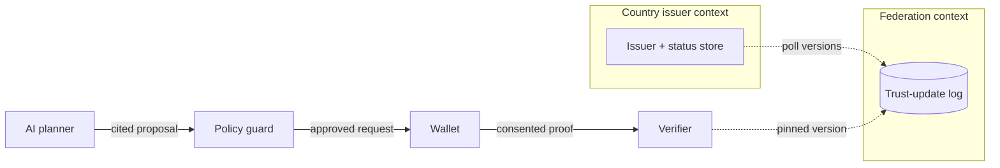

# Sovra enterprise architecture review

**Date:** 2026-10-27 · **Scope:** hackathon prototype, single-host demo scale.
**Method:** direct inspection of every public document and all four packages,
plus primary-source pattern research
(`.intel/research/enterprise-patterns-2026-10-27.md`, git-ignored).
This review improves the existing design for its actual scale. It does not
import production distributed-system machinery.

Related: [system architecture](system-architecture.md),
[decision records](architecture-decision-records.md),
[consistency and failure modes](consistency-and-failure-modes.md),
[data boundaries](data-boundaries-and-trust.md),
[threat model](security-privacy-threat-model.md),
[requirements](../requirements/software-requirements-specification.md),
[evaluation plan](../ai/evaluation-plan.md).

## 1. Existing system analysis

### Vision and objectives

Sovra is an identity-interoperability prototype for the Meta AI hackathon. A
Meta-powered planner discovers unfamiliar issuer schemas and policy documents
through read-only tools and proposes minimal, source-cited evidence plans. All
authorization is deterministic: a policy guard validates plans, holders give
explicit consent, issuers sign narrow attestations, and verifiers check
signatures, trust, status, audience, and single-use challenges. Relying
parties receive verified evidence, never a legal KYC verdict. There is no
global citizen database; identity records stay in jurisdiction-controlled
domains.

### What is implemented (verified in tree)

- `@sovra/shared`: contract types (`VerificationIntent`, `CandidatePlan`,
  `GuardVerdict`, `ProofRequest`, `VerificationResult`, trust/policy inputs)
  and a stable machine-readable outcome-code table.
- `@sovra/policy`: deterministic `validatePlan` with fixed check order
  (recommendation gate, shape, issuer trust, trusted RP-selected policy
  binding, disclosure budget from that policy alone, citation resolution).
  Regression-tested against invented issuers, untrusted claims, over-budget
  disclosure, fabricated citations, policy substitution, and no-path plans.
- `@sovra/credentials`: EdDSA demo attestations and holder proofs binding one
  credential to one verifier challenge (`jose`, extractable in-memory keys).
- `@sovra/verifier`: consent, signature and pinned-trust checks, presenter
  binding, credential-type and required-claim checks, expiry, audience,
  session-nonce match and freshness, atomic single-use consumption, and
  fail-closed status handling. 27 tests green with typecheck and CI.
- Contracts: custom demo orchestration API draft, synthetic fixtures,
  acceptance scorecard (T01–T15), evaluation plan with baseline comparison.

### Decisions worth preserving

- Federated authority with centralized trust metadata only (ADR 001); no
  central IdP in the credential path.
- Modular monolith over microservices (ADR 002); the four packages already
  depend inward (verifier → credentials/shared, policy → shared), which is
  the Clean Architecture dependency rule in practice.
- Narrow signed attestations instead of fake selective disclosure (ADR 003);
  standards honesty over conformance claims (ADR 004).
- AI proposes, code and policy dispose (ADR 006); evidence is not a KYC
  verdict (ADR 011); explicit manual-review state instead of invented success.
- Deferred transactional outbox until a demonstrated need (ADR 009).

## 2. Architecture gap analysis

Each gap states the existing design, then the identified problem. Fixes and
priorities follow in sections 3 and 7.

- **G1 — Guarantees without persistence.** The consistency contract requires
  atomic nonce consumption and terminal `REVOKED`, but enforcement is an
  in-memory `Set` in tests. Problem: the guarantees do not survive restarts
  and cannot be shared across processes.
- **G2 — Required rotation with no rotation procedure.** The threat model
  requires per-issuer key rotation and explicit key IDs. Problem: there is no
  rotation flow, no version-transition handling, and no test.
- **G3 — Fail-closed "as configured" with no configuration.** ADR 008 and the
  SRS defer the issuer-status freshness policy. Problem: operators cannot
  express the freshness bound the verifier is supposed to enforce.
- **G4 — Issuance without idempotency.** Problem: a retried issuance request
  mints duplicate credentials with distinct IDs; there is no idempotency key
  or deduplication record.
- **G5 — Codes without an envelope.** Stable machine-readable codes exist, but
  the documented "common runtime error envelope" is still implementation work
  and the API draft has no versioning strategy. Problem: HTTP mapping,
  retryability signals, and evolution rules are undefined.
- **G6 — Named probes and budgets, not built ones.** `healthz`/`readyz`,
  timeouts, and model-call cost bounds are documented. Problem: no probes,
  timeout/retry budgets, or load-shedding exist in code.
- **G7 — Trust metadata without distribution.** Trust epochs are captured in
  verification records. Problem: how federation updates propagate, how
  versions roll back, and how nodes detect stale metadata are unspecified.
- **G8 — Country nodes without recovery.** Residency nuances are documented.
  Problem: there is no backup, restore, or key-compromise runbook for a
  country node.
- **G9 — Areas without a map.** The five trust areas lack an explicit
  ownership map and language drifts
  (credential vs attestation vs proof, claim vs outcome). Problem: the next
  contributor cannot tell which model each word belongs to.
- **G10 — Audit trail without tamper evidence.** Logs are sanitized and
  correlation IDs exist. Problem: nothing detects later modification of the
  audit trail itself.
- **G11 — Model and endpoint spend without guardrails.** Cost bounding is an
  SRS requirement. Problem: no rate limiting or concurrency caps protect the
  model API or demo endpoints from accidental or hostile exhaustion.

## 3. Recommended improvements

Format per improvement: Existing Design → Identified Problem → Proposed
Improvement → Justification → Trade-offs → Priority.

- **R1 — Durable replay cache and status store.**
  Existing: in-memory `Set`, per-test status callbacks. Problem: G1.
  Improvement: Postgres tables for `consumed_nonces` (unique constraint on
  the nonce, consumed in the verification transaction) and credential status
  with `checked_at` timestamps, as the consistency doc already anticipates.
  Justification: turns the two most load-bearing guarantees into database
  guarantees instead of process memory. Trade-offs: adds a container and a
  migration step; still single-host, no replication. Priority: essential.
- **R2 — Issuance idempotency keys.**
  Existing: none. Problem: G4. Improvement: client-supplied idempotency key
  on issuance; duplicate delivery returns the original credential ID.
  Justification: retries are inevitable in any demo with real networks, and
  duplicates corrupt the evaluation counts. Trade-offs: small table, must
  scope keys per issuer. Priority: essential.
- **R3 — Key rotation procedure.**
  Existing: key IDs and pinning. Problem: G2. Improvement: documented
  rotation (generate, publish, dual-accept window, retire) with a test that
  proofs under the old key verify during the window and fail after.
  Justification: the threat model already promises rotation; an untested
  promise is a finding. Trade-offs: dual-accept temporarily widens the
  attack surface; bound the window. Priority: essential.
- **R4 — Status freshness configuration.**
  Existing: open decision. Problem: G3. Improvement: explicit freshness
  policy (`max_status_age`, `on_unknown: reject|manual_review` per
  assurance level) threaded from RP policy into verification.
  Justification: makes "fail closed as configured" an actual configuration.
  Trade-offs: RP operators must understand the setting; document the default
  (high-assurance rejects unknown). Priority: essential.
- **R5 — Error envelope and API versioning.**
  Existing: codes without HTTP mapping. Problem: G5. Improvement: version
  the demo API (`/v1`), map every outcome code to status + `retryable`
  boolean, freeze the envelope in the OpenAPI draft.
  Justification: lets the demo UI and tests distinguish "retry later" from
  "never" without parsing prose. Trade-offs: minor spec work, no runtime
  cost. Priority: essential.
- **R6 — Health model with budgets.**
  Existing: documented probes. Problem: G6. Improvement: implement
  `healthz`/`readyz`, per-dependency timeouts, bounded model-call
  concurrency, and per-RP rate limits (G11 rides along).
  Justification: the cheapest reliability engineering available; directly
  answers the mission-critical premise that failure handling belongs in the
  application. Trade-offs: timeout values need tuning against real model
  latency; start conservative. Priority: essential.
- **R7 — Glossary and ownership map.**
  Existing: implicit areas. Problem: G9. Improvement: one glossary fixing
  credential/attestation/proof/claim/outcome plus the ownership table in
  section 4;
  treat discovery-tool outputs as untrusted input through an explicit
  anti-corruption layer (the guard already is one — name it).
  Justification: prevents the next contributor from smuggling wallet
  concepts into issuer logic. Trade-offs: documentation only. Priority:
  recommended.
- **R8 — Trust distribution log.**
  Existing: epoch capture. Problem: G7. Improvement: append-only,
  versioned trust-update log the federation publishes and nodes poll, with
  rollback by publishing a superseding version.
  Justification: makes "which trust was live at decision time" auditable
  without a distributed consensus system. Trade-offs: poll-based staleness
  remains; bound it with R4. Priority: recommended.
- **R9 — Tamper-evident audit trail.**
  Existing: sanitized logs. Problem: G10. Improvement: hash-chained
  append-only audit records (each embeds the previous hash).
  Justification: cheap tamper evidence for dispute review. Trade-offs: not a
  substitute for independent log storage; chain verification tooling needed.
  Priority: recommended.
- **R10 — Backup and compromise runbooks.**
  Existing: none. Problem: G8. Improvement: backup/restore and key-compromise
  runbooks for a country node, rehearsed once before the freeze.
  Justification: a demo that cannot survive a laptop failure cannot claim
  operational seriousness. Trade-offs: runbook discipline, no automation
  needed. Priority: recommended.
- **Explicitly rejected:** multi-region active-active, Kafka or event
  backbone, HSM/KMS, full observability platform, blockchain identity.
  Each was evaluated and fails the scale test for an 8-day single-host demo.

## 4. Enhanced system architecture

Keep the modular monolith and the packages. The domain model is one shared
vocabulary (plan, guard, proof, verification mean exactly one thing each);
the five trust areas below are ownership boundaries with explicit
relationships, not separate models:

| Context | Owns | May not own or decide |
| --- | --- | --- |
| Country issuer | Source profiles, signing keys, issuance, status | Another country's data; RP legal decisions |
| Federation registry | Trust-update log, key IDs, scopes, policy refs | Identity records, private keys |
| Wallet | Scoped credentials, consent, holder proofs | Issuer authority keys |
| AI planner | Discovery, ranking, cited proposals | Signatures, consent, trust roots |
| Verifier | Signature/trust/status/audience/nonce checks | KYC sufficiency |

The planner's discovery tools are the anti-corruption layer between the
untrusted issuer-metadata context and the policy language: raw tool outputs
enter only as cited, validated plan fields, never as authority. `statusOf`
key lookup, and consent callbacks stay function-injected ports so Postgres,
in-memory fakes, and future adapters interchange without touching domain
logic. Issuance takes an idempotency key (R2); verification consumes
challenges inside the decision transaction (R1); trust reads pin a log
version (R8).

## 5. Data and workflow design

- **Nonce lifecycle:** verifier mints (`expectedNonce`, expiry) → holder
  binds proof → verifier matches nonce, checks challenge freshness, then
  consumes atomically via unique constraint. Double submission returns
  `REPLAY_DETECTED`; the second writer loses, never both.
- **Credential lifecycle:** `ISSUED → ACTIVE → REVOKED | EXPIRED`;
  `REVOKED` is terminal and a replacement needs a new ID. Status reads
  record `checked_at` against the R4 freshness bound; unknown status fails
  closed at high assurance.
- **Trust lifecycle:** federation appends versioned updates; nodes poll and
  pin the version used per verification record; rollback is a superseding
  version, never history mutation.
- **Key lifecycle:** generate → publish → dual-accept window → retire (R3);
  verification records capture key ID and trust epoch so rotation never
  silently re-trusts.
- **Failure handling:** model/tool/schema/policy errors return
  `PLAN_REJECTED` or `MANUAL_REVIEW`; registry/status outages never become
  successful verifications; expired challenges and unknown issuers reject
  with distinct codes per the R5 envelope.

## 6. Non-functional requirements

Demo-scale, measurable, and consistent with the existing SRS:

- **Reliability:** single-host deployable via Compose; `readyz` fails when
  any critical dependency (database, status source per freshness policy)
  is unhealthy; no successful verification on any dependency outage.
- **Security:** vetted crypto libraries only; exact trust-metadata and key
  binding; audience/nonce/expiry/replay on every presentation; consent
  scoped to RP, purpose, claims, and expiry; logs free of PII, keys, and
  raw proofs.
- **Scalability:** stateless verifier behind the database constraint;
  bounded model-call concurrency; per-RP rate limits. No horizontal scaling
  claims for the demo.
- **Performance:** instrument real latency (model call, tool count, plan
  validation, verification p50/p95) as the evaluation plan requires; no
  invented SLA.
- **Observability:** structured logs with correlation IDs, `status_unknown`
  / `guard_reject` / `signature_reject` counters, and a hash-chained audit
  trail (R9). No metrics-platform dependency.

## 7. Implementation priorities

| Priority | Items | Rationale |
| --- | --- | --- |
| Essential (slice-blocking) | R1 durable replay/status store; R2 issuance idempotency; R3 rotation procedure + test; R4 freshness configuration; R5 error envelope + `/v1`; R6 probes, budgets, rate limits | Without these, documented guarantees are untestable claims. |
| Recommended (do if time) | R7 context map + glossary; R8 trust-update log; R9 hash-chained audit; R10 backup/compromise runbooks | High value, mostly docs and small tables. |
| Future (post-hackathon) | Outbox + async status propagation; standard wallet profiles; accredited governance; HSM/KMS; multi-region | Correctly deferred; revisit only with real users. |

## 8. Architecture decision records (new)

Statuses are proposals for the demo, using the same shape as
[architecture-decision-records.md](architecture-decision-records.md).

| ADR | Status | Decision and rationale | Revisit when |
| --- | --- | --- | --- |
| 013 Durable verification state | Proposed | Postgres tables with a unique nonce constraint and status `checked_at`; guarantees must survive restarts | Deployment target changes |
| 014 Issuance idempotency | Proposed | Client-supplied idempotency key per issuer; redelivery returns the original credential | Issuance volume demands more |
| 015 Key rotation | Proposed | Publish, dual-accept window, retire; old-key proofs fail after the window | Managed PKI available |
| 016 Freshness configuration | Proposed | Explicit `max_status_age` and unknown-status behavior per assurance level | Real risk policy agreed |
| 017 Error envelope + versioning | Proposed | `/v1` API; every outcome code maps to status + retryable flag in the OpenAPI draft | Breaking contract change needed |
| 018 Health model | Proposed | `healthz`/`readyz`, per-dependency timeouts, bounded model concurrency, per-RP rate limits | Production SLOs defined |
| 019 Audit hash chain | Proposed | Append-only records embedding the previous hash; complements, not replaces, log storage | Independent audit review |
| 020 No event backbone (reaffirmed) | Accepted premise | Poll-based status and trust reads; no Kafka; ADR 009 deferral stands | Async propagation proven necessary |
