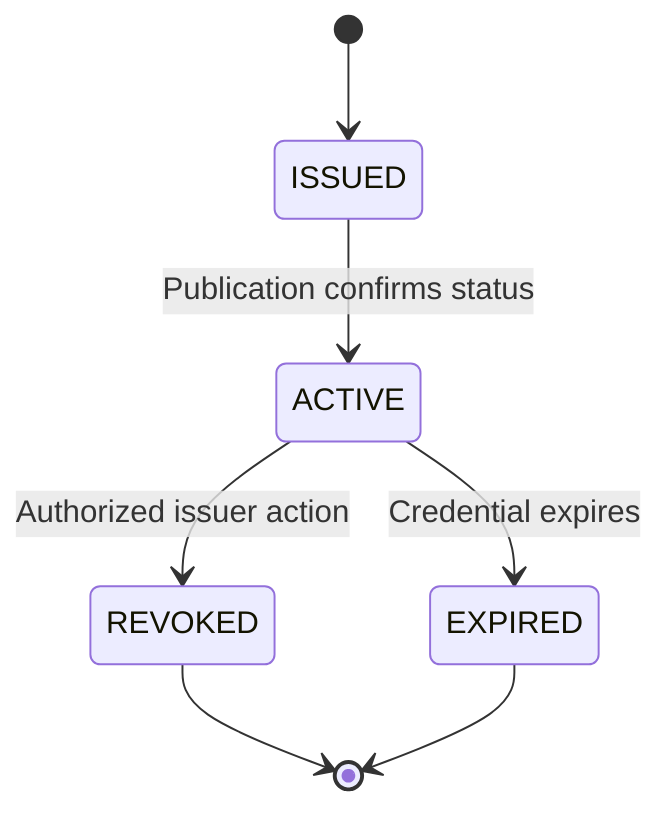

# UML-style sequence and state diagrams

These are proposed hackathon workflows and intentionally **not** normative OpenID4VP/OpenID4VCI wire protocols.

## A. Synthetic issuance

```mermaid
sequenceDiagram
    autonumber
    participant H as Holder / demo UI
    participant I as Country issuer
    participant DB as Country-local store
    participant W as Wallet
    H->>I: Request synthetic adult-status attestation
    I->>DB: Read authorized synthetic attribute
    DB-->>I: Eligible adult flag
    I->>I: Create narrow claim; sign with issuer key
    I-->>W: Signed attestation + status reference
    W-->>H: Credential stored
```

Only the issuer signs an attestation to its source records; the wallet must **not** mint an issuer's credential. This is a demo issuance API, not an assertion of complete OID4VCI implementation.

## B. Dynamic verification across jurisdictions

```mermaid
sequenceDiagram
    autonumber
    participant RP as Mock Australian RP
    participant A as Meta interoperability planner
    participant D as Read-only discovery tools
    participant G as Policy / authorization guard
    participant W as Wallet / holder
    participant V as Verifier
    participant T as Trust metadata + status
    RP->>A: Approved purpose + desired outcome + policy version
    A->>D: Query trusted issuers, schemas and policy sections
    D-->>A: Untrusted documents + structured metadata
    A-->>G: Candidate plan + source anchors
    G->>T: Validate issuer scope/key and known schema
    T-->>G: Trusted configuration
    alt Proposed plan prohibited or missing citation
       G-->>RP: Rejected / manual review
    else Deterministic guard passes
       G->>W: Approved proof request (nonce, audience, claims, expiry)
       W->>W: Present consent prompt
       alt Holder refuses
          W-->>RP: Consent denied
       else Holder approves
          W->>V: Signed credential + challenge-bound holder proof
          V->>T: Issuer keys, scope and revocation/status
          T-->>V: Trusted metadata and active status
          V->>V: Verify signature, audience, nonce, expiry, replay
          V-->>RP: Evidence result; legal KYC not determined
       end
    end
```

## C. Revocation and verification state machine



Verification session transitions: `CREATED -> PLANNING -> PLAN_GUARDED -> AWAITING_CONSENT -> PROOF_RECEIVED -> VERIFIED_EVIDENCE | REJECTED | MANUAL_REVIEW`. Consent denial, model outage, stale status and invalid proof must not bypass intermediate required gates.
