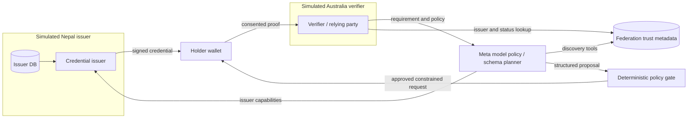

# System architecture

## Selected implementation direction

Use **Java 25 LTS, Spring Boot, Spring Security, Spring AI, and PostgreSQL** for the selected business backend.
The [Java/Spring baseline](java-spring-baseline.md) records verified version candidates and the required security and interoperability gates.
This supersedes the TypeScript backend target; the current TypeScript libraries and tests remain prototype artifacts until the Java migration is implemented and verified.

Keep issuer, verifier, trust metadata, consent, and advisory planner modules behind explicit interfaces, with a small number of deployable processes.
Issuer instances retain separate configuration, signing permissions, and databases for their authority boundaries.
The browser UI can remain React/TypeScript and communicate through versioned API contracts.
Logical trust boundaries matter more than the number of containers.

## Issuer-local document and developer workflows

The business scope also includes an issuer-local encrypted document vault, constrained extraction/review workers, enrollment and source revision workflows, and role-specific dashboards.
The [document lifecycle](federated-document-lifecycle.md) separates source integrity, candidate extracted values, identity/holder validation, and approved issuer claims.
Shared federation/developer services publish approved organizational/capability metadata; subject documents, personal extraction values, digests, and encryption authority stay at the owning node.
The [developer platform](../engineering/developer-platform.md) describes standard mechanisms and Sovra-specific API resources, SDK contracts, and dashboard responsibilities.
Its [issuer-node API draft](../engineering/issuer-node-api.openapi.yaml) is a design artifact, not a running or conformant credential service.

## Trust boundaries

1. Country node owns original source/identity data and private signing keys; it issues only synthetic scoped attestations for the hackathon.
2. Wallet stores signed artifacts and obtains explicit holder consent before presentation.
3. Registry publishes **public issuer metadata** and trusted accreditation/keys/status endpoints, not identity records.
4. Planner receives policies, schema metadata, capability descriptions and *non-sensitive* request context; it must not receive raw passport scans, biometrics or unnecessary PII.
5. Verifier checks proofs locally and applies its own decision policy. Signed claims are evidence, not automatic legal compliance.

## Required production control boundaries

The deployment separates signing, decryption, hostile-file workers, review, deployment/migration and audit identities even where application modules share a repository.
Privileged access uses phishing-resistant enrollment/recovery and bounded elevation; ultimate host/root powers remain an explicit deployment decision.
Recovery fences old writers and preserves or invalidates replay/revocation/trust/approval state before traffic resumes.
Key-copy/cache inventories, artifact admission and semantic readiness are part of the architecture, with measured SEC/MC evidence required for real data.
The [implementation plan](../engineering/implementation-plan.md) and [task backlog](../engineering/implementation-backlog.md) define the gates and dependencies.
The [consistency contract](consistency-and-failure-modes.md) defines security-preserving outage, rollback and recovery behavior.

## Minimal happy path

1. Create synthetic holder in country node N; issue issuer-signed adult-status credential.
2. Registry exposes N's issuer public key, allowed types and status endpoint.
3. Australian mock verifier submits: 'Prove age >= 18 with minimal disclosure' with a policy source and audience.
4. Meta model queries available schemas via tool calls and emits typed plan referencing applicable source sections.
5. Policy gate rejects prohibited fields/issuers, requires holder consent, and creates request with nonce, audience, expiration.
6. Wallet presents dedicated signed adult credential (avoid claiming SD-JWT/ZK unless implemented).
7. Verifier checks signature, issuer trust, time validity, status/revocation, audience/nonce/replay; logs a privacy-minimized outcome.

## Failure path

Disallowed passport-image request must be rejected; altered signature, revoked attestation, expired proof, wrong audience and repeated nonce must fail. If agent cannot interpret a requirement or its model endpoint fails, return 'requires manual review' / fail closed, never an invented valid mapping.

## Future, not MVP

Interoperable issuance/presentation via OpenID4VCI/OpenID4VP, standardized wallet binding and SD-JWT VC selective disclosure, genuine accredited issuer governance, country-specific policy approvals, high-availability registry, HSM/KMS and independent audits.
