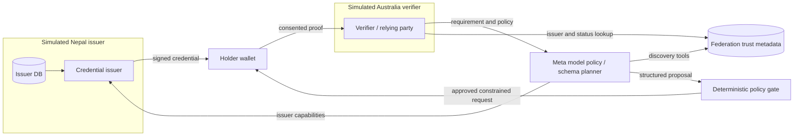

# System architecture

## Suggested implementation shape

Start with a **TypeScript modular monorepo** and a few deployable processes, not enterprise microservices. Suggested directories: `apps/web` (holder/verifier demo), `apps/country-node` (instantiated with separate configs, signing keys, databases), `apps/federation` (issuer trust metadata), `apps/verifier` (verification and replay protection); `packages/credentials`, `packages/policy`, `packages/ai`, `packages/shared`; `tests/fixtures` and end-to-end tests. Logical boundaries matter more than number of Docker containers.

## Trust boundaries

1. Country node owns original source/identity data and private signing keys; it issues only synthetic scoped attestations for the hackathon.
2. Wallet stores signed artifacts and obtains explicit holder consent before presentation.
3. Registry publishes **public issuer metadata** and trusted accreditation/keys/status endpoints, not identity records.
4. Planner receives policies, schema metadata, capability descriptions and *non-sensitive* request context; it must not receive raw passport scans, biometrics or unnecessary PII.
5. Verifier checks proofs locally and applies its own decision policy. Signed claims are evidence, not automatic legal compliance.

## Minimal happy path

1. Create synthetic holder in country node N; issue issuer-signed adult-status credential.
2. Registry exposes N's issuer public key, allowed types and status endpoint.
3. Australian mock verifier submits: 'Prove age >= 18 with minimal disclosure' with a policy source and audience.
4. Meta model queries available schemas via tool calls and emits typed plan referencing applicable source sections.
5. Policy gate rejects prohibited fields/issuers, requires holder consent, and creates request with nonce, audience, expiration.
6. Wallet presents dedicated signed adult credential (avoid claiming SD-JWT/ZK unless implemented).
7. Verifier checks signature, issuer trust, time validity, status/revocation, audience/nonce/replay; logs a privacy-minimized outcome.

## Failure path

Disallowed passport-image request must be rejected; altered signature, revoked attestation, expired proof, wrong audience and repeated nonce must fail. If agent cannot interpret a requirement or its model endpoint fails, return 'requires manual review' / fail closed, never an invented valid mapping.

## Future, not MVP

Interoperable issuance/presentation via OpenID4VCI/OpenID4VP, standardized wallet binding and SD-JWT VC selective disclosure, genuine accredited issuer governance, country-specific policy approvals, high-availability registry, HSM/KMS and independent audits.
